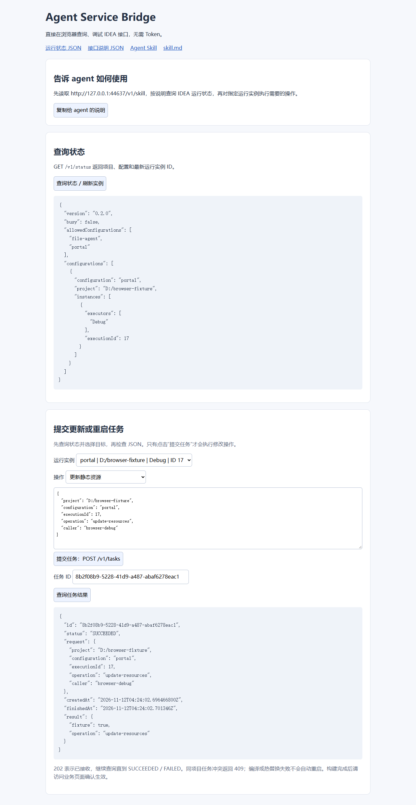
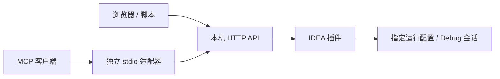

# Agent Service Bridge for IntelliJ IDEA

让 AI agent 操作旧版 IDEA 中的运行服务：启动配置、更新静态资源、HotSwap class、重启指定实例。提供本机 HTTP API、浏览器调试页和独立 MCP 适配器。

**适用场景：** 项目依赖旧版 IntelliJ IDEA，无法直接使用当前官方内置 MCP Server，又希望 agent 修改代码后能自行更新应用。[JetBrains 官方 MCP 从 IDEA 2025.2 开始内置](https://www.jetbrains.com/help/idea/mcp-server.html)。本项目不依赖该内置服务。

> 当前安装包声明 IDEA **2024.2 Ultimate / 242.***，实测 **2024.2.6**。这不代表已经支持所有 2025.2 及以下版本；Community 和其他版本的状态见 [兼容范围](COMPATIBILITY.md)。本项目为独立社区项目。

[下载插件](https://github.com/ParadiseWitch/idea-service-bridge/releases/latest) · [MCP 接入](mcp-adapter/README.md) · [Agent Skill](skills/idea-service-bridge/SKILL.md) · [测试与限制](TESTING.md)

## 能做什么

- 启动尚未运行的配置，默认 Debug，也可指定 Run；拒绝重复启动。
- 更新应用服务器的静态资源，对目标 Debug 会话执行 class 热替换。
- 精确重启指定项目、配置和运行实例，保留原 Run/Debug 模式。
- 查询任务状态、编译错误和执行结果；编译或 HotSwap 失败不会自动重启。
- 同一项目的修改任务互斥，避免多个 agent 同时操作共享编译输出。
- 浏览器直接调试，无需 Token；也可通过 MCP 工具或 PowerShell 使用。

不提供全局停止、关闭 IDEA、任意 Action 或任意命令执行接口。接口只监听 `127.0.0.1`，用于本机开发。

## 安装并打开帮助页

1. 从 [Releases](https://github.com/ParadiseWitch/idea-service-bridge/releases) 下载 `idea-agent-bridge-0.3.0.zip`。
2. IDEA 打开 **Settings → Plugins → 齿轮 → Install Plugin from Disk**，选择 ZIP。
3. 点击 **Tools → Agent Service Bridge → 启动 / 查看连接信息**。
4. 浏览器打开 **http://127.0.0.1:17891/help**。弹窗会列出实际接口地址。

也可通过 GitHub CLI 下载：

```powershell
gh release download v0.3.0 --repo ParadiseWitch/idea-service-bridge --pattern 'idea-agent-bridge-0.3.0.zip'
```

开启 Agent 接口只开启控制接口，不会自动启动或停止业务服务。

插件已在隔离环境验证动态安装、卸载和更新，但 **不能保证所有 IDEA 状态都无需重启**。例如其他插件已有待重启更新时，IDEA 2024.2 的全局标记会阻止动态安装。遇到 Restart IDE 提示，先保留现有服务，在合适维护窗口处理；不要反复安装或清空其他插件的更新队列。



## 让 agent 使用

最简单的方式，告诉 agent：

> 先读取 http://127.0.0.1:17891/v1/skill，按说明查询状态，再操作指定的 IDEA 运行配置。

也可以将 [skills/idea-service-bridge](skills/idea-service-bridge) 复制到 agent 的技能目录。该目录包含 SKILL.md、接口参考和可独立运行的 PowerShell 脚本，不依赖本机原工程路径。

### 标准 MCP 接入

独立适配器使用 Node.js 22+，通过 stdio 暴露 7 个 MCP 工具，再转发到已有 HTTP API；它不是在 IDEA 里额外安装一套官方 MCP。

```powershell
gh repo clone ParadiseWitch/idea-service-bridge
cd idea-service-bridge/mcp-adapter
npm ci --ignore-scripts
```

在支持 `mcpServers` 格式的客户端中配置（替换为实际克隆路径）：

```json
{
  "mcpServers": {
    "idea-service-bridge": {
      "command": "node",
      "args": ["C:/tools/idea-service-bridge/mcp-adapter/src/index.mjs"],
      "env": {"IDEA_BRIDGE_URL":"http://127.0.0.1:17891"}
    }
  }
}
```

工具：`idea_list_configurations`、`idea_start_configuration`、`idea_update_resources`、`idea_update_classes_and_resources`、`idea_restart_configuration`、`idea_get_task`、`idea_get_help`。

客户端连接后先查询配置，修改操作返回任务 ID，再查询任务结果。适配器更新后只需重连对应 MCP，不需要因此重启 IDEA。详见 [MCP 说明](mcp-adapter/README.md)。



## HTTP 与 PowerShell

所有 API 无需 Token。默认端口 17891，支持在 settings.json 中修改。

| 请求 | 用途 |
|---|---|
| `GET /help` 或 `/` | 浏览器帮助与交互调试页 |
| `GET /v1/status` | 查询项目、配置、实例 ID、执行模式和端口 |
| `GET /v1/help` | JSON 接口说明与示例 |
| `GET /v1/skill` 或 `/skill.md` | 供 agent 读取的 Markdown 使用说明 |
| `POST /v1/tasks` | 提交启动、更新或显式重启任务 |
| `GET /v1/tasks/{id}` | 查询 RUNNING、SUCCEEDED、FAILED 和结果 |

**启动配置：**

```json
{"project":"C:/projects/my-app","configuration":"portal","operation":"start","executor":"Debug","caller":"agent-session-a"}
```

**更新已有实例：**

```json
{"project":"C:/projects/my-app","configuration":"portal","executionId":123,"operation":"update-resources","caller":"agent-session-a"}
```

123 只是格式示例，必须使用最新状态查询得到的 ID。其他操作值为 `update-classes-and-resources`、`restart`。重启后实例 ID 会变化。

```powershell
./tools/agent-bridge.ps1 -Operation status
./tools/agent-bridge.ps1 -Operation start -Project C:/projects/my-app -Configuration portal -Caller agent-session-a -Wait
./tools/agent-bridge.ps1 -Operation update-resources -Project C:/projects/my-app -Configuration portal -ExecutionId 123 -Caller agent-session-a -Wait
./tools/agent-bridge.ps1 -Operation task -TaskId '返回的任务 UUID'
```

## 配置和运行边界

首次启动在当前 IDEA 配置目录生成 `agent-service-bridge/settings.json`：

```json
{"port":17891,"allowedConfigurations":["portal","file-agent"]}
```

`portal`、`file-agent` 是默认白名单示例，替换为自己的准确运行配置名。停止 **Agent 接口** 后编辑该文件，再开启接口生效。`connection.json` 保存实际 baseUrl、版本和 PID。多个 IDEA 实例使用不同端口。

- **HotSwap：** 需要支持热替换的目标 Debug 会话；应用服务器更新要求本地 exploded 部署。结构变化失败时不会自动重启。Run 模式 class 更新被拒绝。
- **异步任务：** HTTP 202 只是接收成功。客户端等待超时不代表任务已取消，保留任务 ID 后继续查询。
- **业务就绪：** `processStarted=true` 不代表应用已经可用。资源构建完成或部署通知已提交也不证明页面已生效，需另做业务 HTTP 检查。
- **多 agent：** 项目锁不能隔离共享源码修改，也不能阻止用户手动编译。编译可能包含其他 agent 已写入磁盘的代码，维护共享服务前仍需协调。
- **拒绝条件：** 同项目已有修改任务、正在索引/编译、存在未保存编辑内容、实例 ID 过期或配置/实例不唯一。

## 从源码构建

当前构建流程使用 Windows PowerShell、JDK 21+ 的 `java` / `javac` / `jar`，以及完整的 IntelliJ IDEA Ultimate 2024.2 安装目录。不重新下载 IDEA SDK，不需要 Maven/Gradle 依赖。

```powershell
$env:IDEA_HOME = 'C:/Program Files/JetBrains/IntelliJ IDEA 2024.2.6'
./build.ps1                         # 编译、单元测试、打包
./build.ps1 -Task test              # 编译和单元测试
./build.ps1 -Task sandbox           # 再做独立 SDK 集成测试
# 或显式传入安装目录：
./build.ps1 -IdeaHome 'C:/path/to/IDEA'

cd mcp-adapter
npm ci --ignore-scripts
npm test
npm run smoke                      # 只读访问正在运行的插件
```

安装包位于 `build/idea-agent-bridge-0.3.0.zip`。沙箱配置、缓存和日志位于 `.sandbox/`；测试使用临时端口及独立 JVM，不拿业务服务做可随意停止的测试夹具。

## 测试与兼容范围

已验证 12 项 Java 测试、10 项 MCP 测试，以及独立 SDK 中的 HTTP 启动、定向重启、双 Debug 会话 HotSwap、动态卸载与重新加载。浏览器交互在模拟后端验证。

**真实 Tomcat exploded WAR 的资源部署效果尚未完成端到端验证。** 当前声明 `242.*`，实测仅 2024.2.6 Ultimate；2024.3～2025.2 和更早版本不在当前支持范围内。后续应按目标 SDK 适配验证，不能只放宽版本号。

详见 [TESTING.md](TESTING.md)、[COMPATIBILITY.md](COMPATIBILITY.md) 和 [更新记录](CHANGELOG.md)。
